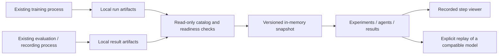

# Training-linked app — proposed design for the next session

Date: 7 October 2026. Repository inspected at `3b6953a`, branch `JMF-2340550-results-tab`.
This is a planning deliverable. No app code, training code, results or models were changed for it.

Execution roles explicitly chosen by the user on 7 October: **GPT 6.1 Sol** (`gpt-6.1-sol`) orchestrates/plans and owns integration/verification; **GPT 6 Luna** (`gpt-6-luna`) implements bounded tasks as worker sub-agents; **GPT 6 Astra** (`gpt-6-astra`) is used only for a specific escalation Sol cannot resolve. All use reasoning effort **`high`**. The implementation plan defines dispatch, file ownership and escalation criteria. These are development roles, not changes to the app's trained policies or model integrations.

## 1. Brief and boundaries

The explanatory learning app is complete for this stage. The next project is to improve `app/` into an interactive workspace for the team's actual training runs, trained agents and evaluation results. When supported artifacts arrive in this local repository, the open app should discover and display them without a server restart, a browser reload, or an edit to a hard-coded experiment list.

Keep these two products separate:

| Product | Purpose | Location |
|---|---|---|
| Explanatory Simulation | Learn the mechanics and the project's ideas | `Explanatory Simulation/`, port 8765 |
| Training and agent workspace | Inspect actual runs, actions, episodes and results | `app/`, existing simulation server on port 8000 |

Reuse the explanatory app's standard of mechanical clarity, Arabic/English support, dark/light themes and mobile usability. Do not merge its server, React runtime or teaching controls into `app/`. The existing app uses Python/FastAPI and native JavaScript modules with locally vendored Three.js.

The automatic link is to files present locally. Training may run elsewhere, but remote files must first be copied or synchronised here by an independently configured process. Cloud jobs, remote access and synchronisation are outside this plan.

## 2. Findings verified from the files

| Evidence | What exists | Consequence |
|---|---|---|
| `app/README.md`, `app/server.py` | `/simulation` replays car logs; `/agents` runs trained policies; `/results` reads experiment results; `/`, `/driver`, `/review` serve the supervisor | Improve the existing product and routes; do not start another app |
| `app/results_data.py:discover_evaluations`, `build` | Discovers `results/*_seed*.txt` on each request; agent-set JSON is not included yet | Preserve R1a and add the unfinished agent-set reader |
| `app/static/sim/results.mjs:load`, `agents.mjs:loadCatalog` | Results and catalog fetched once at page startup; episode frame polling is a different mechanism | A new artifact does not currently update an already-open page |
| `app/agent_catalog.py:discover` | Finds direct children such as `runs_c4/sighted_seed0`; its `runs` parameter is one directory name | Does not discover `runs/<set>/sighted_seed0`, the layout used by `train_all.py` |
| `app/agent_catalog.py:protocol_of`, `app/agent_trace.py` | Replay protocols are registered as `phase-d` and `d2`; trace/road use the current fixed episode definition | Discovering a new training layout does not prove that its replay protocol is supported |
| `train.py:_train_and_save` | Saves atomic `final.zip` first, then record/metadata/curve files, then sets `config.status = finished`; releases `RUNNING` afterward | A final ZIP by itself is not the completion of the entire export |
| `train.py:ActionRecorder` | Writes record chunks every 10,000 steps; merged recording and curve at the end | Training progress has discrete evidence; do not invent a smooth live percentage |
| `fingerprint.py:running_pid` | Existing liveness check for the process named by `RUNNING` | Use it; the existence of the marker alone does not prove training is active |
| `train_all.py` | Prints the next `record_agents.py` command after training; does not invoke it | Training completion and evaluation publication are separate events |
| `record_agents.py` | Writes member artifacts before writing the set's `index.json`; uses direct JSON/NPZ writes | Readers must tolerate incomplete writes and validate consistency |
| `app/agent_api.py:EpisodeStore` | In-memory cache keyed by `(runs, seed, episode)` | A replacement model at the same path must not reuse an old trace |
| `app/results_provenance.py`, `agent_catalog.py` | Plant provenance and replay refusal checks already exist | Keep them; old results may be displayed even when their models cannot run on this plant |
| `app/start-simulation.ps1` | Uses bare `python`, warns if SB3 missing; works from the root it derives | Make interpreter selection explicit and verify its capabilities |

Local availability at inspection:

- `results/agents/terrain_dt1`: index plus 24 policy summaries, including 20 trained agents and four hand-written policies.
- `results/agents/sep19_110kmh`: index plus 14 policy summaries.
- Neither set contains `train_record.npz` or `eval_record.npz` in this checkout.
- `runs/terrain_dt1` is absent here. Historical direct-layout folders `runs/`, `runs_d2/`, `runs_c4/` exist.
- Missing recordings do not make the summaries unusable. A training recording that was never saved cannot be reconstructed from the final policy.

These are file/source findings, not a fresh browser or full regression-test result. Recheck at execution time.

## 3. Design choice

Use a lightweight local artifact catalog with in-memory snapshots and short polling. This fits the current GET-based APIs and works when files are copied into the repository on Windows.

Alternatives considered:

- A filesystem watcher plus WebSocket/SSE: possible, but adds lifecycle and reconnect machinery before the artifact contracts are settled. Keep as a later transport optimisation if polling measurements justify it.
- Make training push directly to the browser: couples long-running training to the app and misses results copied from another machine. Do not use as the primary link.

Target flow:



Opening a page, refreshing the catalog or seeing a new model must not start training, evaluation, model inference or an external language-model request. Existing explicit replay controls remain available. The result of training becomes visible automatically; an evaluation that has not been produced is labelled as pending rather than fabricated.

## 4. Artifact identity and readiness

Keep three facts separate for every agent:

1. Training lifecycle: `running`, `finalizing`, `finished`, `interrupted`, `unknown`.
2. Available evidence: final model, training curve, training recording, evaluation summary, evaluation recording, published verdict.
3. Compatibility: replay allowed, refused with the existing reason, or unknown.

Example: “Training finished · evaluation not published · replay refused: different plant” is a valid state. A finished old run is not a failed training run merely because the current simulator differs.

Discovery is bounded to these families:

```text
runs*/<sighted|blind>_seedN/
runs*/<set>/<sighted|blind>_seedN/
results/*_seed*.txt
results/agents/<set>/index.json
results/agents/<set>/<published-policy>/...
```

No recursive scan of the whole repository, `node_modules`, the explanatory app, ZIP contents or record chunks on every poll. Skip symlink/junction escapes after resolving paths. Browser requests use server-issued IDs, never arbitrary filesystem paths. Preserve existing direct-layout URLs through a compatibility resolver.

An ID identifies a location; a revision identifies its content generation. Revisions include relevant metadata, model identity, record/index changes and provenance dependencies. Do not merge runs solely because their paths, set names or seeds match. Do not use a filename as proof that a model was evaluated.

Readiness rules:

- Ignore temporary ZIPs such as `final.saving.zip`.
- Inspect changed files only after two unchanged size/mtime observations at least one second apart. Check stats before and after parsing; retry when they move.
- Parse JSON, validate required structures and verify ZIP readability through the existing budget reader. Stability is a retry heuristic, not proof of a coherent multi-file publication.
- A live `RUNNING` process wins over a pre-existing final ZIP. A stale marker plus `status=running` means interrupted/unknown, not finished.
- Modern completion uses `config.status=finished`, no active writer, a readable final model, and consistent recorded counts/metadata. Legacy runs without config get a distinct legacy-evidence explanation; do not hide them or invent an exact finish time.
- Agent-set membership comes from `index.json.policies`; stale directories not named there do not become members.
- Before publishing a set snapshot, validate each named member and the values duplicated between index and summaries. Retain the prior coherent snapshot with an explicit “updating / last valid snapshot” label during replacement. With no prior snapshot, show a pending/error state for that set only.
- Where older files lack generation hashes, say that identity cannot be fully verified. Never present a mixture as a verified new generation. New exports should use unique run/set names; a stronger producer manifest can be designed separately if same-directory replacement must be transactional.
- Archive deletion or unreadable files must not silently leave stale results labelled current.

## 5. Automatic updates and cost

While a lab page is visible, check for changes every 2 seconds, with only one request and one scan/build in flight. When hidden, pause browser polling and refresh immediately on return. Back off on a disconnected server (2, 4, 8, then 30 seconds) and show the last successful update time. Stop timers and requests on page exit.

Initial target: a small, valid finished metadata/summary publication appears within 5 seconds on the local machine with an open visible tab. Measure this; large recordings may appear first as “validating recording”. Do not claim that a multi-gigabyte record has loaded within the same bound.

Cheap scans use file metadata. Hash a changed binary once after stability; cache by its resolved path and signature. Do not re-read every final model, decompress every NPZ or repeat all Git provenance work every 2 seconds. Maintain separate revisions for training, results and replay inputs. A new checkpoint must not rebuild unrelated result charts.

Include the loaded-vs-disk plant distinction in revision checking. If physics or derived inputs change, keep the existing restart-needed warning and refuse a supposedly fresh replay against a stale in-process plant. Do not hot-reload the scientific model.

An update must preserve the selected experiment/pair/episode, timeline time, pause/play state, open details, keyboard focus and scroll position when their source generation is unchanged. New runs enter the list without forcibly taking selection. If the selected source changes, stop its playback, identify the changed source, and require a new explicit replay selection; never blend frames or model answers across revisions.

## 6. User experience

**User's graphics update, 7 October:** [B58 Preview Study](https://claude.ai/artifact/16mUxgXuHMzLppvT9Df4rM) is the visual reference. The required 25 analytical panels, exact local data sources, additional decision timelines, interactions and per-milestone coverage are specified in `docs/superpowers/specs/2026-10-07-training-linked-app-visuals.md`. Read it as part of this spec. Use the reference's presentation/interaction patterns with the current project's data and provenance.

Use one consistent shell for the simulation routes. Keep the primary screen centred on the selected agent and the current time. Secondary details open on demand.

| Surface | Main question | Contents |
|---|---|---|
| Experiment strip/catalog | What arrived and what is ready? | Run identity, pair count, lifecycle, available artifacts, last update, compatibility, links to results and agent view |
| Agent view | What did this agent do at this step? | Real observation, command, applied action, limits, reward terms, resulting engine state; source and time stay visible |
| Comparison | How do the selected policies differ? | Same episode, time, weights, protocol and evidence generation; synchronised charts and views |
| Results | What do the completed evaluations establish? | Within-experiment pairs, total/thermal damage, fuel, tracking, worst episodes, provenance and quoted verdict |
| Car-log replay | What happened in the recording? | Existing measured/estimated/unavailable channels; remains distinct from agent evaluation |

Arabic first, complete English strings, dark/light throughout changed routes. Reuse the shared preference keys. No translation may drop the source/limitation that qualifies a number.

The mechanical upgrade should make the turbo, intake/exhaust, cooling paths and the five actuator effects understandable while the selected sample drives the readings. Any schematic airflow/rotation whose actual flow/speed was not recorded is labelled as schematic. Do not infer a measured turbo RPM, compressor map, gas flow, gear or combustion state from a decorative animation. Use temperature units and node names accurately: exhaust-gas temperature and turbine-metal temperature are different channels.

The presentation may interpolate camera/car position for smoothness. Numeric telemetry, rewards and actions stay at the selected recorded sample. Recorded training actions are commands; show applied actions only when the recording actually contains them or an explicitly supported authoritative decoder provides them. A changed colour is not an extra scientific result.

## 7. Existing results work to retain

R1a is implemented. The approved results design and its review notes already specify R1b (agent sets) and R2 (simulator/car comparisons):

- `docs/superpowers/specs/2026-09-30-results-tab-design.md`
- `docs/superpowers/plans/2026-10-05-results-tab-r1a-review-notes.md`

Use them for the unfinished sections; do not duplicate or silently discard them. This new plan explicitly extends their open-page behaviour from “read on open” to automatic refresh and adds a read-only view of training artifacts. Their result-provenance rules still apply.

R1b includes the `terrain_dt1` reader, both damage measures, recorded curves/action statistics, knock-margin comparisons, incomplete/test/record states and the specified post-hoc analysis contract. A missing published analysis means “verdict unavailable”; the UI must not derive a new significance claim. Creating `analyse_agent_set.py` and writing its capture is a separate scientific-work deliverable under the old spec, not a background action by the app.

R2 remains a later, explicitly planned milestone, C1 in the implementation plan, covering the remaining reference figures. Re-read `VALIDATION_PLAN_REVIEW.md` and the then-current validation plan before implementing it: do not convert older authored status pills into numerical validation certificates. New experiments keep their own plant/protocol/budget and are not pooled with old experiments. The new graphics request adds the data-gated episode viewer G11 previously excluded by the old results spec; it does not lift that spec's provenance or scientific-claim constraints.

## 8. Execution sequence and acceptance

1. **First session: reliable discovery and automatic refresh.** Baseline current app; add flat/nested discovery, readiness, revisions and a minimal bilingual live catalog in `/agents`; refresh existing `/results` when relevant supported files change; fix stale replay identity. Verify with temporary fixtures, not a training run.
2. **Results coverage.** Deliver R1b's agent-set data and interactive charts. The two sets already on disk become visible with truthful missing-record states.
3. **Recorded decisions.** Add lazy, bounded readers for available training/evaluation NPZ records, step navigation and evidence-linked comparisons. Preserve explicit compute replay for compatible final policies; unsupported protocols remain visible with a reason.
4. **Mechanical and visual upgrade.** Audit live desktop/mobile screens, then improve the model, camera, airflow/cooling presentation and density around the selected data sample. Reference the completed explanatory lab visually without modifying it.
5. **Reference graphics and whole-flow verification.** Complete C1/R2's simulation/car figures and G01–G25 coverage. Check both languages/themes at desktop and phone viewport sizes, artifact arrival/replacement/deletion, offline/reconnect, missing data, incompatible models, and a short reproducible launcher. Keep actual-phone network access separate from viewport testing.

Completion means an already-open app notices a newly published supported run/result, shows the right source and readiness, and lets the user inspect its available evidence without manual refresh or mixing experiments. No actual training, expensive reevaluation, external model call, network exposure, commit or push is part of this planning request.
