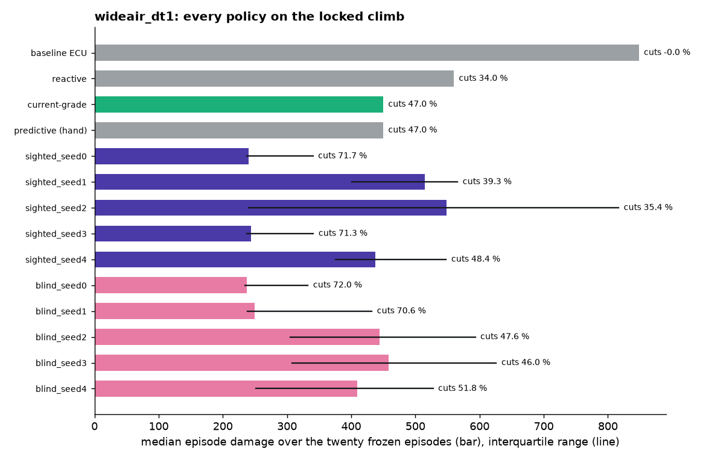
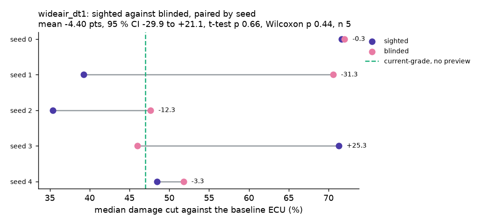
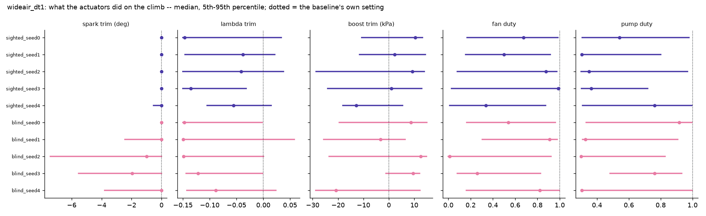
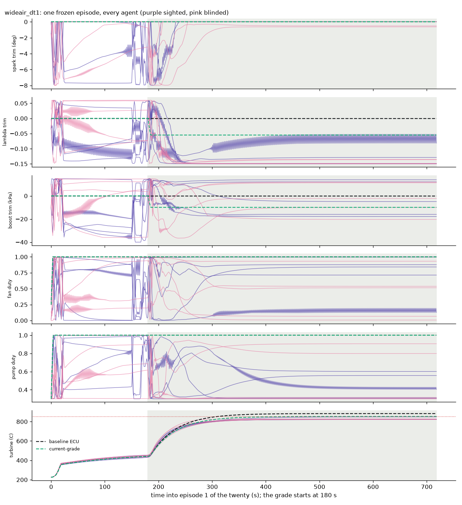
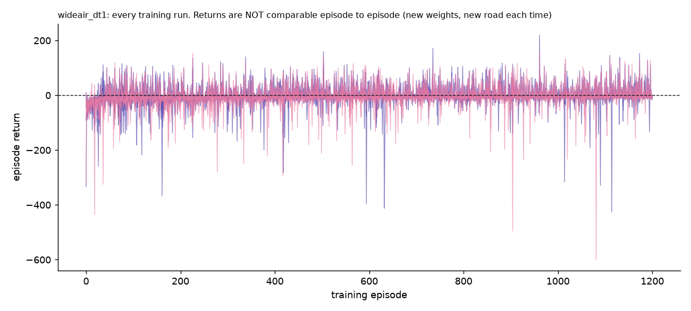

# Agents: `wideair_dt1`

Generated by `python record_agents.py` -- do not edit by hand; re-run it.

## How they were trained

- **roads**: the extremes roads (decision 12) in wider air: ambient 0-45 C and pressure 80-101.3 kPa drawn per episode, the compressor inlet following the pressure (wide_air.WideAirTrainingEnv, X2)
- **dt**: 1.0
- **steps**: 1080000
- **total_timesteps**: 1080000
- **steps_per_episode**: 900
- **device**: cpu
- **status**: finished
- **config_source**: written by train.py during training
- **SAC**: {"learning_rate": 0.0003, "buffer_size": 1000000, "batch_size": 256, "learning_starts": 100, "gamma": 0.99, "tau": 0.005, "train_freq": "TrainFreq(frequency=1, unit=<TrainFrequencyUnit.STEP: 'step'>)", "gradient_steps": 1, "ent_coef": "auto", "target_entropy": -5.0, "policy": "MlpPolicy", "net_arch": "[256, 256]"}
- **plant data fingerprint**: `{"data_sha1": "c4fdd4babfb3752a", "raw_logs": ["3aca2ec1-20260907_072817.csv", "3f64372e-20260907_070041.csv", "670063b2-20260907_142018.csv", "683640a0-2026090`

## Scored on the twenty frozen episodes (`evaluate.EPISODES`)

The locked 12 % / 130 km/h climb, 720 s at dt 1.0, 42 C. Scores are `evaluate.run_episode`'s; 280 episodes were compared with `results/phase_d_130kmh_raw.json` and are identical.

| policy | preview | median damage | IQR | worst | cut % | thermal-only cut % | fuel vs baseline % | peak turbine C | torque violation (median) | episodes trained | wall min |
|---|---|---|---|---|---|---|---|---|---|---|---|
| baseline ECU | no | 848.1 | 848-848 | 848.1 | 0.0 | 0.0 | +0.00 | 883 | 0.0 | - | - |
| reactive | no | 559.7 | 560-560 | 559.7 | 34.0 | 34.1 | +3.06 | 860 | 0.0 | - | - |
| current-grade | no | 449.6 | 450-450 | 449.6 | 47.0 | 47.2 | +5.85 | 853 | 0.1 | - | - |
| predictive (hand) | yes | 449.7 | 450-450 | 449.7 | 47.0 | 47.2 | +5.96 | 853 | 0.1 | - | - |
| sighted_seed0 | yes | 240.2 | 237-340 | 749.4 | 71.7 | 71.6 | +20.22 | 875 | 0.0 | 1201 | 3082.0 |
| sighted_seed1 | yes | 515.1 | 401-566 | 840.4 | 39.3 | 39.1 | +5.13 | 883 | 0.0 | 1201 | 3079.9 |
| sighted_seed2 | yes | 548.2 | 240-817 | 865.0 | 35.4 | 35.4 | +6.27 | 883 | 0.0 | 1201 | 3066.1 |
| sighted_seed3 | yes | 243.7 | 238-341 | 466.4 | 71.3 | 71.2 | +19.08 | 854 | 0.0 | 1201 | 3072.0 |
| sighted_seed4 | yes | 437.3 | 375-548 | 870.5 | 48.4 | 48.3 | +7.00 | 883 | 0.0 | 1201 | 3078.6 |
| blind_seed0 | no | 237.3 | 234-333 | 710.9 | 72.0 | 72.0 | +20.00 | 873 | 0.1 | 1201 | 3089.7 |
| blind_seed1 | no | 249.6 | 238-432 | 918.3 | 70.6 | 70.5 | +21.81 | 886 | 0.2 | 1201 | 3080.3 |
| blind_seed2 | no | 444.1 | 305-593 | 749.8 | 47.6 | 47.6 | +24.25 | 877 | 0.0 | 1201 | 3081.1 |
| blind_seed3 | no | 457.8 | 308-626 | 1713.1 | 46.0 | 45.9 | +20.13 | 916 | 0.0 | 1201 | 3071.6 |
| blind_seed4 | no | 408.9 | 252-527 | 776.9 | 51.8 | 51.7 | +13.28 | 876 | 0.0 | 1201 | 3087.8 |

## What stands out

- SPARK. The trim is capped at 0 for this set (engine_env.SPARK_TRIM_MAX): no agent can advance past the baseline, whose own spark on the climb is 1.2 deg. The median applied trim on the climb runs -2.0 to +0.0 deg across the agents, and the modelled knock integral's 95th percentile 0.62-0.63, against the baseline's 0.61 and the 0.85 knee where the damage model starts charging.
- SIGHTED_SEED2 does MORE damage than the baseline ECU on 1 of 20 episodes (numbers 12; worst 865 against 848, peak turbine 883 C). Their weight on component life is 0.034. It is not trading life for fuel: on those episodes it burns +1.4 % fuel against the baseline, and its return is -6; by evaluate.py's own standard a protection policy that is sometimes terrible is not one.
- SIGHTED_SEED4 does MORE damage than the baseline ECU on 1 of 20 episodes (numbers 1; worst 871 against 848, peak turbine 883 C). Their weight on component life is 0.136. It is not trading life for fuel: on those episodes it burns +1.3 % fuel against the baseline, and its return is -9; by evaluate.py's own standard a protection policy that is sometimes terrible is not one.
- BLIND_SEED1 does MORE damage than the baseline ECU on 5 of 20 episodes (numbers 7, 12, 14, 15, 16; worst 918 against 848, peak turbine 886 C). Their weight on component life is 0.089, 0.034, 0.029, 0.049, 0.062 -- exactly the lowest in the frozen set. It is not trading life for fuel: on those episodes it burns +2.0, +2.5, +2.9, +2.6, +2.5 % fuel against the baseline, and its return is -5, -8, -7, -8, -6; by evaluate.py's own standard a protection policy that is sometimes terrible is not one.
- BLIND_SEED3 does MORE damage than the baseline ECU on 4 of 20 episodes (numbers 12, 14, 15, 16; worst 1713 against 848, peak turbine 916 C). Their weight on component life is 0.034, 0.029, 0.049, 0.062 -- exactly the lowest in the frozen set. It is not trading life for fuel: on those episodes it burns +8.1, +8.8, +7.7, +8.5 % fuel against the baseline, and its return is -28, -31, -27, -33; by evaluate.py's own standard a protection policy that is sometimes terrible is not one.
- 7 of 10 agents beat the best hand-written policy on median damage (47.0 % cut). 0 burn less fuel than the baseline.

## The ablation, paired by seed

Sighted minus blinded damage cut, 5 pairs: mean **-4.40** points (median -3.34, sd 20.51), 95 % CI -29.87 to +21.06; paired t-test p = 0.656, exact Wilcoxon p = 0.438 (the smallest this n can give is 0.0625). Thermal-only damage (no knock term): mean -4.40 points, t-test p = 0.657.

| seed | sighted cut % | blinded cut % | difference | sighted minus current-grade |
|---|---|---|---|---|
| 0 | 71.67 | 72.01 | -0.34 | +24.69 |
| 1 | 39.26 | 70.56 | -31.31 | -7.72 |
| 2 | 35.36 | 47.64 | -12.28 | -11.62 |
| 3 | 71.27 | 46.01 | +25.25 | +24.28 |
| 4 | 48.44 | 51.78 | -3.34 | +1.45 |

## What the actuators did

Applied values after the slew limit, over all twenty episodes; median and 5th-95th percentile, flat road | climb. `neutral` is the baseline's own setting (trims 0; fan and pump at what the baseline runs). `slew %` is the share of steps where the policy asked for more movement than the slew limit allowed.

| policy | spark trim (deg) | lambda trim | boost trim (kPa) | fan duty | pump duty |
|---|---|---|---|---|---|
| baseline ECU | 0.00 [0.00, 0.00] &#124; 0.00 [0.00, 0.00]; slew 0 % | 0.00 [0.00, 0.00] &#124; 0.00 [0.00, 0.00]; slew 0 % | 0.00 [0.00, 0.00] &#124; 0.00 [0.00, 0.00]; slew 0 % | 1.00 [1.00, 1.00] &#124; 1.00 [1.00, 1.00]; slew 0 % | 1.00 [1.00, 1.00] &#124; 1.00 [1.00, 1.00]; slew 1 % |
| reactive | 0.00 [0.00, 0.00] &#124; 0.00 [0.00, 0.00]; slew 0 % | 0.00 [0.00, 0.00] &#124; -0.04 [-0.04, 0.00]; slew 0 % | 0.00 [0.00, 0.00] &#124; -7.37 [-7.40, 0.00]; slew 0 % | 1.00 [1.00, 1.00] &#124; 1.00 [1.00, 1.00]; slew 0 % | 1.00 [1.00, 1.00] &#124; 1.00 [1.00, 1.00]; slew 1 % |
| current-grade | 0.00 [0.00, 0.00] &#124; 0.00 [0.00, 0.00]; slew 0 % | 0.00 [0.00, 0.00] &#124; -0.06 [-0.06, -0.06]; slew 0 % | 0.00 [0.00, 0.00] &#124; -9.90 [-9.90, -9.90]; slew 0 % | 1.00 [1.00, 1.00] &#124; 1.00 [1.00, 1.00]; slew 0 % | 1.00 [1.00, 1.00] &#124; 1.00 [1.00, 1.00]; slew 1 % |
| predictive (hand) | 0.00 [0.00, 0.00] &#124; 0.00 [0.00, 0.00]; slew 0 % | 0.00 [-0.06, 0.00] &#124; -0.06 [-0.06, -0.06]; slew 0 % | 0.00 [-9.90, 0.00] &#124; -9.90 [-9.90, -9.90]; slew 0 % | 1.00 [1.00, 1.00] &#124; 1.00 [1.00, 1.00]; slew 0 % | 1.00 [1.00, 1.00] &#124; 1.00 [1.00, 1.00]; slew 1 % |
| sighted_seed0 | -1.11 [-6.34, 0.00] &#124; 0.00 [0.00, 0.00]; slew 3 % | 0.03 [-0.14, 0.06] &#124; -0.15 [-0.15, 0.03]; slew 3 % | -4.48 [-30.89, 14.33] &#124; 10.46 [-10.66, 13.30]; slew 1 % | 0.73 [0.04, 0.98] &#124; 0.67 [0.17, 0.98]; slew 1 % | 0.99 [0.34, 1.00] &#124; 0.54 [0.31, 0.98]; slew 1 % |
| sighted_seed1 | -0.90 [-7.70, 0.00] &#124; 0.00 [0.00, 0.00]; slew 2 % | -0.04 [-0.12, 0.05] &#124; -0.04 [-0.15, 0.02]; slew 26 % | -23.26 [-37.78, 13.79] &#124; 2.27 [-11.51, 14.43]; slew 1 % | 0.87 [0.17, 0.99] &#124; 0.50 [0.15, 0.91]; slew 4 % | 0.57 [0.31, 1.00] &#124; 0.30 [0.30, 0.80]; slew 1 % |
| sighted_seed2 | 0.00 [-1.99, 0.00] &#124; 0.00 [0.00, 0.00]; slew 2 % | -0.05 [-0.13, 0.05] &#124; -0.04 [-0.15, 0.04]; slew 30 % | -15.23 [-23.58, 14.30] &#124; 9.28 [-28.58, 13.93]; slew 0 % | 0.68 [0.02, 0.93] &#124; 0.88 [0.08, 0.97]; slew 2 % | 0.94 [0.46, 1.00] &#124; 0.35 [0.30, 0.97]; slew 1 % |
| sighted_seed3 | 0.00 [-7.51, 0.00] &#124; 0.00 [0.00, 0.00]; slew 3 % | 0.05 [-0.06, 0.06] &#124; -0.14 [-0.15, -0.03]; slew 24 % | 1.61 [-36.53, 14.74] &#124; 1.01 [-24.08, 12.94]; slew 1 % | 0.63 [0.00, 1.00] &#124; 0.99 [0.03, 1.00]; slew 5 % | 0.84 [0.31, 0.99] &#124; 0.36 [0.30, 0.72]; slew 1 % |
| sighted_seed4 | -4.50 [-7.96, 0.00] &#124; 0.00 [-0.54, 0.00]; slew 3 % | -0.02 [-0.14, 0.04] &#124; -0.06 [-0.10, 0.01]; slew 29 % | -30.02 [-39.94, 13.40] &#124; -12.84 [-18.09, 5.37]; slew 2 % | 0.34 [0.01, 0.98] &#124; 0.34 [0.01, 0.87]; slew 2 % | 0.39 [0.30, 0.97] &#124; 0.76 [0.31, 1.00]; slew 1 % |
| blind_seed0 | 0.00 [-5.53, 0.00] &#124; 0.00 [0.00, 0.00]; slew 1 % | 0.04 [-0.03, 0.06] &#124; -0.15 [-0.15, -0.00]; slew 5 % | 3.06 [-20.00, 14.62] &#124; 8.70 [-19.55, 14.99]; slew 2 % | 0.79 [0.18, 0.97] &#124; 0.54 [0.16, 0.96]; slew 2 % | 0.95 [0.30, 1.00] &#124; 0.92 [0.33, 1.00]; slew 1 % |
| blind_seed1 | 0.00 [-6.66, 0.00] &#124; 0.00 [-2.45, 0.00]; slew 2 % | 0.06 [0.03, 0.06] &#124; -0.15 [-0.15, 0.06]; slew 2 % | -17.94 [-38.22, 13.46] &#124; -3.33 [-25.67, 6.35]; slew 2 % | 0.98 [0.56, 1.00] &#124; 0.91 [0.30, 0.98]; slew 1 % | 0.32 [0.30, 0.85] &#124; 0.33 [0.31, 0.91]; slew 1 % |
| blind_seed2 | -1.18 [-6.30, 0.00] &#124; -0.99 [-7.44, 0.00]; slew 1 % | 0.04 [-0.07, 0.06] &#124; -0.15 [-0.15, 0.00]; slew 9 % | -4.66 [-26.65, 12.03] &#124; 12.57 [-23.51, 14.79]; slew 1 % | 0.45 [0.09, 0.92] &#124; 0.01 [0.00, 0.92]; slew 1 % | 0.57 [0.32, 0.78] &#124; 0.30 [0.30, 0.83]; slew 1 % |
| blind_seed3 | -1.92 [-5.81, 0.00] &#124; -1.96 [-5.53, 0.00]; slew 6 % | 0.03 [-0.04, 0.06] &#124; -0.12 [-0.14, -0.00]; slew 6 % | -8.79 [-38.46, 13.22] &#124; 9.54 [-1.17, 12.04]; slew 2 % | 0.43 [0.05, 0.98] &#124; 0.26 [0.08, 0.83]; slew 3 % | 0.54 [0.34, 0.98] &#124; 0.76 [0.48, 0.93]; slew 1 % |
| blind_seed4 | 0.00 [-5.94, 0.00] &#124; 0.00 [-3.80, 0.00]; slew 11 % | -0.04 [-0.12, 0.01] &#124; -0.09 [-0.14, 0.02]; slew 17 % | 6.61 [-24.43, 13.94] &#124; -20.73 [-28.81, 12.19]; slew 1 % | 0.87 [0.37, 1.00] &#124; 0.82 [0.16, 1.00]; slew 3 % | 0.45 [0.31, 0.88] &#124; 0.30 [0.30, 1.00]; slew 2 % |

## Files

Per policy, in its folder: `eval_summary.json` (every episode scored), `eval_record.npz` (every step of the twenty episodes, arrays `[episode, step, ...]`: `action`, `applied`, `obs`, `reward`, `r_fuel`, `r_life`, `r_resp`, `rpm`, `map_kpa`, `grade`, `spark`, `lam`, `torque`, `torque_req`, `ki`, `egt_c`, `mdot_fuel`, `t_turb`, `t_oil`, `t_block`, `t_turb_base`, `damage_rate`, plus `episode_seed` and `weights`). Per agent also: `config.json`, `curve.csv`, `policy.npz` (the actor's weights) and, for agents trained since 29 September, `train_record.npz` (every training step: `step`, `episode`, `action`, `obs`, `reward`, the reward terms and the engine state).

**The two `*_record.npz` files are kept on disk and not in git** (the team's decision, 29 September: 85 MB of binaries). They stay on the machine that trained the agents, beside the models in `runs/` (also gitignored): only there can `python record_agents.py <set>` regenerate `eval_record.npz`, and `train_record.npz` cannot be regenerated at all. Everything else here is committed, and `eval_summary.json` carries the statistics read from the records.

## Figures

_33 min to generate._
